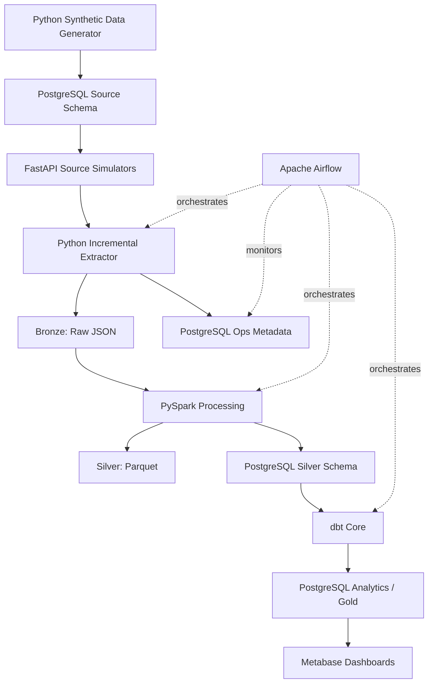

# Media Ads Intelligence Platform
### Project Documentation · Version 1.0

<p align="center">
  <strong>A multi-channel advertising data platform for reliable ingestion, transformation, analytics, and business intelligence.</strong>
</p>

<p align="center">
  
  
  
  
</p>

---

## 1. Executive Summary

The **Media Ads Intelligence Platform** is an end-to-end data engineering and analytics project designed to consolidate advertising performance data from **Meta Ads, Google Ads, and YouTube reporting** into a consistent analytical model.

The platform simulates advertising data sources and APIs, extracts data incrementally, preserves raw source records, standardizes and validates data with PySpark, models analytics-ready datasets with dbt, orchestrates workflows with Apache Airflow, and exposes business insights through Metabase dashboards.

The project is designed as a practical, locally runnable portfolio implementation. It emphasizes data engineering fundamentals: incremental ingestion, idempotency, lineage, data quality, late-arriving updates, dimensional modeling, testing, and operational observability.

> **Important reporting note:** YouTube is part of Google's advertising ecosystem. In this project it is represented as a separate reporting channel/source adapter to demonstrate multi-source ingestion. Reports must avoid counting the same Google Ads and YouTube-reported activity twice.

## 2. Business Problem

Marketing teams often review performance across separate advertising platforms. Each platform may use different field names, data types, reporting conventions, and attribution rules. This makes consolidated reporting difficult and can lead to inconsistent KPIs.

This platform addresses the following needs:

- Consolidate campaign, ad, audience, budget, and daily performance data.
- Standardize source-specific schemas into common analytical definitions.
- Track spend, impressions, clicks, conversions, and platform-attributed revenue.
- Compare campaign and channel performance using consistent calculations.
- Detect unusual changes in spend or performance.
- Monitor ingestion health, rejected records, and data quality.
- Provide a reusable foundation for business dashboards and future analytics.

### 2.1 Intended users

| User | Questions the platform should help answer |
|---|---|
| Marketing manager | How are campaigns performing overall? |
| Campaign manager | Which campaigns or ads need attention? |
| Channel analyst | How do Meta, Google, and YouTube reporting channels compare? |
| Audience analyst | Which audience segments respond best? |
| Data engineer | Did ingestion and processing complete correctly? |
| Business stakeholder | Are spend, conversions, and attributed revenue moving as expected? |

## 3. Goals and Scope

### 3.1 Version 1.0 goals

1. Generate realistic synthetic advertising data.
2. Simulate source APIs for Meta, Google, and YouTube reporting.
3. Store source entities and operational metadata in PostgreSQL.
4. Extract data incrementally using watermarks and batch tracking.
5. Preserve raw API responses in a Bronze data layer.
6. Standardize and validate data with PySpark into Silver datasets.
7. Publish Silver data to PostgreSQL so dbt can model it.
8. Build dimensional models and business marts with dbt Core.
9. Orchestrate daily processing with Apache Airflow.
10. Detect basic data and business anomalies.
11. Present results and pipeline health in Metabase.

### 3.2 Out of scope for Version 1.0

- Live production integrations with Meta or Google credentials.
- Real-time streaming and sub-minute processing.
- Person-level customer tracking or personally identifiable audience data.
- Multi-currency conversion and foreign-exchange policy.
- Advanced machine-learning attribution or forecasting.
- Automated campaign changes or write access to advertising platforms.

These can be considered in later versions.

## 4. Technology Stack

| Area | Technology | Responsibility |
|---|---|---|
| Synthetic data | Python, Faker, NumPy | Generate clients, campaigns, ads, audiences, and metrics |
| Simulated APIs | FastAPI | Expose REST endpoints with filtering and pagination |
| Source storage | PostgreSQL | Store generated source entities and reporting data |
| API extraction | Python, Requests | Call APIs, paginate, retry, and extract incrementally |
| Raw data lake | Local filesystem, JSON | Preserve immutable source payloads |
| Columnar storage | Parquet | Store processed datasets efficiently |
| Distributed processing | PySpark | Standardization, deduplication, validation, and transformations |
| Analytics modeling | dbt Core, dbt-postgres | Build tested staging, intermediate, dimension, fact, and mart models |
| Orchestration | Apache Airflow | Schedule and coordinate daily workflows |
| BI | Metabase | Build business and operational dashboards |
| Containerization | Docker Desktop | Run local services consistently |
| Future AI interface | Ollama, Streamlit | Optional read-only natural-language analytics assistant |

**Environment direction:** The initial implementation targets a local Windows development machine using Docker Desktop with WSL2. Python, Java, Spark, Airflow, and dbt versions will be pinned during environment setup to avoid dependency conflicts.

## 5. High-Level Architecture



### 5.1 Data flow

1. **Generate:** Python creates synthetic clients, platforms, campaigns, ads, audiences, budgets, and performance records.
2. **Serve:** FastAPI exposes source-like endpoints with date filters, updated-since filters, and pagination.
3. **Extract:** A Python client calls the endpoints, handles retries, and retrieves only new or changed records.
4. **Land:** Original JSON responses are written to Bronze with batch and ingestion metadata.
5. **Transform:** PySpark standardizes names and types, deduplicates records, validates data, and routes invalid rows to quarantine.
6. **Publish Silver:** Curated datasets are written to Parquet and loaded into PostgreSQL's `silver` schema for dbt consumption.
7. **Model Gold:** dbt builds tested dimensions, facts, and reporting marts in the `analytics` schema.
8. **Orchestrate:** Airflow runs the daily workflow and records execution outcomes.
9. **Visualize:** Metabase connects to the analytics schema and operational datasets.

### 5.2 Why both Parquet and PostgreSQL Silver?

Parquet provides an efficient, portable columnar representation of the curated lake data. dbt Core with the PostgreSQL adapter operates on PostgreSQL relations, not arbitrary local Parquet files. Therefore, Version 1.0 writes Silver Parquet files and publishes corresponding curated tables into PostgreSQL's `silver` schema. dbt reads those PostgreSQL tables as sources.

This is a practical local architecture, not a claim that PostgreSQL is a lakehouse.

## 6. Data Layers and Naming

| Layer | Purpose | Typical format/location | Mutability |
|---|---|---|---|
| Source | Simulated platform/source records | PostgreSQL `source` schema | Mutable source state |
| Operations | Watermarks, batches, logs, quality results | PostgreSQL `ops` schema | Operational updates |
| Bronze | Original source API payloads | JSON files | Append-only |
| Silver | Standardized, validated records | Parquet + PostgreSQL `silver` schema | Reprocessed by affected batch/partition |
| Gold | Business dimensions, facts, and marts | PostgreSQL `analytics` schema | dbt-managed |

Suggested local lake layout:

```text
data/
├── bronze/
│   ├── meta/
│   │   ├── campaigns/
│   │   ├── ads/
│   │   └── performance/
│   ├── google/
│   │   ├── campaigns/
│   │   ├── ads/
│   │   └── performance/
│   └── youtube/
│       ├── campaigns/
│       ├── ads/
│       └── performance/
├── silver/
│   ├── campaigns/
│   ├── ads/
│   ├── ad_performance/
│   ├── audience_performance/
│   └── campaign_budget/
└── quarantine/
    └── <dataset>/
```

A practical file partitioning convention is `source=<source>/entity=<entity>/ingest_date=YYYY-MM-DD/batch_id=<id>/`. Partitioning and file sizing will be finalized during implementation.

## 7. Source Data Model

The initial source model contains eight business tables. All performance data is synthetic and uses INR in Version 1.0.

### 7.1 `clients`

**Purpose:** Stores advertiser/client organizations whose campaigns are analyzed.

| Column | Meaning |
|---|---|
| `client_id` | Primary key identifying a client |
| `client_name` | Display name of the advertiser |
| `industry` | Business industry/category |
| `country` | Client's country |
| `currency_code` | Reporting currency; INR in V1 |
| `created_at` | Initial creation timestamp |
| `updated_at` | Last source update timestamp |

Example:

| client_id | client_name | industry | country | currency_code |
|---|---|---|---|---|
| CL001 | UrbanKart | Retail | India | INR |

**Business importance:** Enables client-level filtering, portfolio comparisons, and client-specific reporting.

### 7.2 `platforms`

**Purpose:** Reference data for each simulated reporting channel.

| Column | Meaning |
|---|---|
| `platform_id` | Primary key for the platform |
| `platform_name` | Meta, Google, or YouTube |
| `platform_type` | Broad channel/category classification |

Example:

| platform_id | platform_name | platform_type |
|---|---|---|
| PL01 | Meta | Social |
| PL02 | Google | Search |
| PL03 | YouTube | Video |

**Business importance:** Allows channel comparisons and platform-specific filtering. YouTube is modeled as a separate reporting channel for this project.

### 7.3 `campaigns`

**Purpose:** Stores campaign configuration and ownership.

| Column | Meaning |
|---|---|
| `campaign_id` | Campaign identifier |
| `client_id` | Client foreign key |
| `platform_id` | Platform foreign key |
| `campaign_name` | Human-readable campaign name |
| `campaign_objective` | Goal, such as Awareness, Traffic, Leads, or Sales |
| `campaign_status` | Draft, Active, Paused, Completed, etc. |
| `start_date` | Campaign start date |
| `end_date` | Planned/actual end date; may be null |
| `total_budget` | Campaign's configured budget |
| `currency_code` | Currency of the budget |
| `created_at`, `updated_at` | Source lifecycle timestamps |

Example:

| campaign_id | client_id | platform_id | campaign_name | campaign_objective | campaign_status | total_budget |
|---|---|---|---|---|---|---:|
| CMP001 | CL001 | PL01 | Summer Sale | Sales | Active | 150000.00 |

**Business importance:** Campaign is a central reporting entity. It connects client, platform, ads, budgets, and performance.

### 7.4 `ads`

**Purpose:** Stores individual advertisements/creatives associated with campaigns.

| Column | Meaning |
|---|---|
| `ad_id` | Ad identifier |
| `campaign_id` | Parent campaign foreign key |
| `ad_name` | Ad/creative name |
| `creative_type` | Image, Video, Carousel, etc. |
| `placement` | Where the ad appears |
| `status` | Current ad status |
| `created_at`, `updated_at` | Source lifecycle timestamps |

Example:

| ad_id | campaign_id | ad_name | creative_type | placement | status |
|---|---|---|---|---|---|
| AD001 | CMP001 | Summer Banner A | Image | Feed | Active |

**Business importance:** Supports creative and placement comparisons, such as whether video or image ads perform better.

### 7.5 `audiences`

**Purpose:** Synthetic audience-segment reference data. No person-level records or PII are stored.

| Column | Meaning |
|---|---|
| `audience_id` | Audience segment identifier |
| `audience_name` | Segment name |
| `age_group` | Synthetic age band |
| `gender` | Synthetic segment attribute; may include Unknown/All |
| `location` | Geographic segment |
| `interest_category` | Interest grouping |

Example:

| audience_id | audience_name | age_group | gender | location | interest_category |
|---|---|---|---|---|---|
| AUD001 | Young Tech Shoppers | 18-24 | All | Maharashtra | Technology |

**Business importance:** Enables aggregate audience-segment analysis without modeling individual users.

### 7.6 `ad_daily_performance`

**Purpose:** Daily performance metrics at the ad reporting grain.

**Initial grain:** One record per ad, report date, and source reporting segment. In the simplified V1 source model, this is one current record per ad/date.

| Column | Meaning |
|---|---|
| `performance_id` | Source row primary key |
| `ad_id` | Ad foreign key |
| `report_date` | Date to which metrics belong |
| `impressions` | Number of ad displays |
| `clicks` | Number of clicks |
| `spend` | Advertising cost for the reporting period |
| `conversions` | Count of configured conversion events |
| `attributed_revenue` | Revenue attributed by the source platform |
| `video_views` | Reported video views; may be zero/not applicable |
| `source_updated_at` | Source-side update timestamp for incremental extraction |
| `created_at`, `updated_at` | Source record lifecycle timestamps |

Example:

| performance_id | ad_id | report_date | impressions | clicks | spend | conversions | attributed_revenue | video_views |
|---|---|---|---:|---:|---:|---:|---:|---:|
| PERF001 | AD001 | 2026-10-29 | 25000 | 820 | 12500.00 | 41 | 52000.00 | 0 |

**Business importance:** Primary fact source for campaign, ad, and platform performance reporting.

### 7.7 `ad_audience_performance`

**Purpose:** Daily performance broken down by ad and audience segment.

**Grain:** One record per ad + audience + report date.

| Column | Meaning |
|---|---|
| `audience_performance_id` | Source row primary key |
| `ad_id` | Ad foreign key |
| `audience_id` | Audience segment foreign key |
| `report_date` | Reporting date |
| `impressions` | Segment impressions |
| `clicks` | Segment clicks |
| `conversions` | Segment conversions |
| `spend` | Segment spend |
| `source_updated_at` | Source-side update timestamp |

Example:

| audience_performance_id | ad_id | audience_id | report_date | impressions | clicks | conversions | spend |
|---|---|---|---|---:|---:|---:|---:|
| AP001 | AD001 | AUD001 | 2026-10-29 | 9000 | 340 | 19 | 4600.00 |

**Business importance:** Supports audience-level efficiency and conversion analysis. Do not add this table's metrics to ad-level totals; it is a breakdown of performance at a different grain.

### 7.8 `campaign_daily_budget`

**Purpose:** Daily budget allocation and actual spend at campaign level.

**Grain:** One record per campaign + report date.

| Column | Meaning |
|---|---|
| `budget_id` | Source row primary key |
| `campaign_id` | Campaign foreign key |
| `report_date` | Budget reporting date |
| `allocated_budget` | Planned budget for the date |
| `actual_spend` | Reported spend for the date |
| `source_updated_at` | Source-side update timestamp |

Example:

| budget_id | campaign_id | report_date | allocated_budget | actual_spend |
|---|---|---|---:|---:|
| BUD001 | CMP001 | 2026-10-29 | 5000.00 | 4825.00 |

**Business importance:** Enables budget pacing and overspend/underspend monitoring. Budget allocation is not the same measure as actual ad spend.

### 7.9 Source-model implementation notes

- Source identifiers may collide across platforms. Use a platform/source scope in business keys, or create globally unique internal keys.
- Add source account identifiers if needed to distinguish multiple advertiser accounts on one platform.
- Enforce uniqueness at the true reporting grain, not just on a generated row ID.
- Use decimal/numeric types for money, not floating-point types.
- Define whether campaign budget is lifetime budget or daily allocation; the daily budget table represents daily allocation.
- If the simulated APIs revise historical reports, update `source_updated_at` so incremental extraction can discover the revision.

## 8. Operational Metadata Model

Operational tables make the pipeline observable and recoverable. They are stored in PostgreSQL's `ops` schema.

| Table | Key fields | Purpose |
|---|---|---|
| `ingestion_watermarks` | source_name, entity_name, last_successful_watermark, last_batch_id, updated_at | Tracks the last successfully committed extraction point |
| `ingestion_batches` | batch_id, source_name, entity_name, started_at, completed_at, extracted_count, status, error_message | Records each entity extraction attempt |
| `pipeline_execution_logs` | execution_id, pipeline_name, execution_date, started_at, completed_at, status, records_processed, error_details | Tracks end-to-end pipeline runs |
| `data_quality_results` | quality_check_id, batch_id, dataset_name, check_name, total_records, passed_records, failed_records, check_status, checked_at | Stores validation outcomes |
| `rejected_records` | rejection_id, batch_id, dataset_name, source_record_id, rejection_reason, rejected_at | Audits records rejected or quarantined by validation |

### 8.1 Watermark and batch rules

1. Read the last successful watermark for a source entity.
2. Extract records updated after that point, with a configurable overlap window where appropriate.
3. Persist the raw response and batch metadata durably.
4. Process and publish the batch successfully.
5. Advance the watermark only after the required durable writes succeed.
6. Make reruns idempotent so the same source record does not create duplicate current-state rows.

A failed batch must not advance the watermark. Retrying a batch should be safe.

## 9. Bronze Layer — Raw Data

Bronze preserves source-native API payloads with minimal modification. It is the replayable record of what the simulated platform returned.

### 9.1 Dataset families

| Source | Raw datasets |
|---|---|
| Meta | campaigns, ads, performance |
| Google | campaigns, ads, performance |
| YouTube | campaigns, ads, performance |

Audience and budget endpoints may be included in the simulated API as separate entities or returned through reporting endpoints, depending on the implementation.

### 9.2 Common ingestion metadata

Each raw record/file should be traceable to:

- `source_platform`: Meta, Google, or YouTube.
- `source_entity`: campaigns, ads, performance, etc.
- `source_record_id`: identifier from the source response.
- `source_updated_at`: source update timestamp, when provided.
- `ingestion_timestamp`: time the pipeline received the record.
- `batch_id`: extraction batch identifier.
- `payload`: original source JSON fields.

### 9.3 Source-specific examples

Source payloads intentionally differ. Examples below are illustrative, not exact live API contracts.

**Meta-like performance payload**

```json
{
  "campaign_id": "meta_cmp_1001",
  "ad_id": "meta_ad_2001",
  "date_start": "2026-10-29",
  "impressions": "25000",
  "clicks": "820",
  "spend": "12500.00",
  "conversions": "41",
  "actions": { "purchase_value": "52000.00" },
  "updated_time": "2026-10-30T01:00:00Z"
}
```

**Google-like performance payload**

```json
{
  "campaign": { "id": "g_cmp_1001" },
  "ad_group_ad": { "ad": { "id": "g_ad_2001" } },
  "segments": { "date": "2026-10-29" },
  "metrics": {
    "impressions": "25000",
    "clicks": "820",
    "cost_micros": "12500000000",
    "conversions": "41",
    "conversions_value": "52000.00"
  }
}
```

Google's `cost_micros` is a currency amount multiplied by 1,000,000 and must be converted using the documented currency convention.

**YouTube-like performance payload**

```json
{
  "campaign_id": "yt_cmp_1001",
  "video_id": "yt_video_2001",
  "report_date": "2026-10-29",
  "impressions": 18000,
  "clicks": 260,
  "views": 7200,
  "spend": 8400.00,
  "conversions": 12,
  "updated_at": "2026-10-30T01:15:00Z"
}
```

**Business importance:** Bronze allows debugging, reprocessing, auditability, and transformation changes without calling the source API again.

## 10. Silver Layer — Standardized and Validated Data

Silver is the conformed layer. PySpark maps platform-specific fields to a common schema, applies data types, deduplicates, validates, and enriches records.

### 10.1 Standardized datasets

| Silver dataset | Contains | Main business use |
|---|---|---|
| `silver_clients` | Standardized client attributes | Client reporting |
| `silver_platforms` | Platform/channel reference | Channel reporting |
| `silver_campaigns` | Standard campaign attributes and source keys | Campaign analysis |
| `silver_ads` | Standard ad and creative attributes | Creative analysis |
| `silver_audiences` | Synthetic audience segment attributes | Audience analysis |
| `silver_ad_performance` | Daily ad-level metrics | Core performance reporting |
| `silver_audience_performance` | Daily ad/audience metrics | Segment performance |
| `silver_campaign_budget` | Daily campaign budget and actual spend | Budget pacing |

### 10.2 Example: `silver_ad_performance`

| Column | Description |
|---|---|
| `source_platform` | Standard platform/channel name |
| `source_account_id` | Source advertising account, when modeled |
| `source_campaign_id` | Original platform campaign identifier |
| `source_ad_id` | Original platform ad identifier |
| `report_date` | Standard date type |
| `impressions` | Standard integer count |
| `clicks` | Standard integer count |
| `spend` | Standard decimal currency amount |
| `conversions` | Standard decimal or integer count, based on source semantics |
| `attributed_revenue` | Standard decimal currency amount |
| `video_views` | Standard view count |
| `source_updated_at` | Source-side revision timestamp |
| `ingestion_timestamp` | Pipeline ingestion timestamp |
| `batch_id` | Batch lineage identifier |
| `record_hash` | Hash used to identify changed content |

Example:

| source_platform | source_ad_id | report_date | impressions | clicks | spend | conversions | attributed_revenue |
|---|---|---|---:|---:|---:|---:|---:|
| Meta | meta_ad_2001 | 2026-10-29 | 25000 | 820 | 12500.00 | 41 | 52000.00 |

### 10.3 Standardization and transformation rules

- Normalize source-specific column names into the common naming convention.
- Convert dates and timestamps to consistent types and timezone rules.
- Convert monetary values to decimal types and normalize source units, such as Google micros.
- Standardize platform, campaign objective, status, creative type, and placement values.
- Preserve source identifiers and source update timestamps for lineage.
- Deduplicate by the source's actual business key, keeping the latest valid source update.
- Validate foreign-key relationships between campaigns, ads, clients, and platforms.
- Route invalid records to quarantine with a clear rejection reason.
- Reprocess affected dates/partitions when late-arriving updates are received.

### 10.4 Initial data quality checks

| Check | Expected behavior | Treatment |
|---|---|---|
| Required identifiers | Required IDs are not null/blank | Quarantine invalid rows |
| Valid date | Report date parses and is in an acceptable range | Quarantine invalid rows |
| Numeric metrics | Counts and monetary values parse correctly | Quarantine or flag |
| Non-negative metrics | Impressions, clicks, spend, and conversions are non-negative | Quarantine invalid rows |
| Referential integrity | Ad references a known campaign; campaign references known client/platform | Quarantine or defer if late dimension arrives |
| Duplicate grain | No duplicate row at the declared business grain | Deduplicate and record outcome |
| Clicks vs impressions | For this synthetic V1 data, clicks should not exceed impressions | Quarantine/flag; revisit if source semantics differ |
| Audience reconciliation | Segment totals reconcile to ad totals when segments are generated as exhaustive and mutually exclusive | Flag mismatch |
| Budget consistency | Daily allocation and spend are non-negative | Flag invalid values; overspend is a business alert, not automatically bad data |

Not every unusual value is a data error. For example, spend above allocated budget may be valid source data and should normally become a business alert rather than be discarded.

## 11. Gold Layer — Analytics Model

Gold is the business-facing analytical layer, built with dbt Core and PostgreSQL.

### 11.1 Dimensional model

The model uses dimensions for descriptive context and facts for measurable events.

#### Dimensions

| Model | Key attributes | Purpose |
|---|---|---|
| `dim_client` | client_key, client_id, client_name, industry, country, currency_code | Client slicing |
| `dim_platform` | platform_key, platform_id, platform_name, platform_type | Channel slicing |
| `dim_campaign` | campaign_key, campaign_id, client_key, platform_key, campaign_name, objective, status, dates, budget, valid_from, valid_to, is_current | Campaign context and history |
| `dim_ad` | ad_key, ad_id, campaign_id, campaign_key, ad_name, creative_type, placement, status | Ad/creative context |
| `dim_audience` | audience_key, audience_id, audience_name, age_group, gender, location, interest_category | Audience context |
| `dim_date` | date_key, full_date, day, month, month_name, quarter, year, day_of_week, is_weekend | Calendar analysis |

**Historical tracking:** `dim_campaign` is planned as a Slowly Changing Dimension Type 2 (SCD2) model. When tracked campaign attributes change, the previous version is closed with `valid_to` and `is_current = false`, and a new version is inserted. This allows historical reports to retain the campaign context valid at the time.

#### Facts

| Model | Grain | Measures |
|---|---|---|
| `fact_ad_performance` | One ad + date + source reporting segment | impressions, clicks, spend, conversions, attributed_revenue, video_views |
| `fact_audience_performance` | One ad + audience + date | impressions, clicks, spend, conversions |
| `fact_campaign_budget` | One campaign + date | allocated_budget, actual_spend |

Fact tables use surrogate dimension keys such as `date_key`, `ad_key`, `campaign_key`, `client_key`, `platform_key`, and `audience_key` where applicable.

**Grain discipline is essential:** Never join facts at different grains and then sum duplicated measures. Audience performance is a breakdown of ad performance, not an additional set of impressions/clicks/spend to add to the ad fact.

### 11.2 dbt project structure

```text
dbt/
└── advertising_analytics/
    ├── dbt_project.yml
    ├── models/
    │   ├── staging/
    │   │   ├── stg_clients.sql
    │   │   ├── stg_campaigns.sql
    │   │   ├── stg_ads.sql
    │   │   └── stg_ad_performance.sql
    │   ├── intermediate/
    │   └── marts/
    │       ├── dimensions/
    │       ├── facts/
    │       └── reporting/
    ├── snapshots/
    ├── tests/
    └── seeds/
```

dbt responsibilities:

- Declare PostgreSQL Silver tables as dbt sources.
- Use `source()` to reference input relations and `ref()` to reference other dbt models.
- Build staging, intermediate, dimensions, facts, and reporting marts.
- Use view, table, or incremental materializations based on volume and workload.
- Add `not_null`, `unique`, `relationships`, and accepted-value tests.
- Use dbt snapshots or a controlled SCD2 model for campaign history.
- Document models and columns in YAML.

PySpark handles raw-to-conformed processing; dbt handles SQL-based analytical modeling. These responsibilities are intentionally separate.

## 12. Business Reporting Marts

The following marts are the primary sources for Metabase dashboards.

| Mart | Grain | Key measures / questions |
|---|---|---|
| `mart_campaign_performance` | Campaign + date | Spend, attributed revenue, impressions, clicks, conversions, CTR, CPC, CPA, ROAS |
| `mart_platform_performance` | Platform + date | Channel totals and efficiency comparison |
| `mart_audience_performance` | Audience + date (and optional platform/campaign) | Segment spend, response, conversion efficiency |
| `mart_creative_performance` | Creative type + date + platform | Image/video/carousel comparison |
| `mart_daily_advertising_summary` | Date | Daily overall spend, revenue, delivery, and efficiency |

### 12.1 Planned Metabase dashboards

1. **Executive Overview** — spend, attributed revenue, conversions, ROAS, trends, and top campaigns.
2. **Campaign Performance** — campaign status, budget pacing, spend, conversions, CPA, and ROAS.
3. **Platform Performance** — Meta vs Google vs YouTube reporting channel comparison.
4. **Audience & Creative Insights** — audience segment and creative-type performance.
5. **Pipeline Health & Anomalies** — latest batch status, record counts, failed checks, rejected rows, and detected anomalies.

## 13. KPI Definitions and Formulas

| KPI | Formula | Interpretation |
|---|---|---|
| CTR | clicks / impressions × 100 | Share of impressions that resulted in clicks |
| CPC | spend / clicks | Average cost per click |
| CPM | spend / impressions × 1,000 | Cost per thousand impressions |
| Conversion rate | conversions / clicks × 100 | Simplified click-to-conversion rate |
| CPA | spend / conversions | Average advertising cost per conversion |
| ROAS | attributed revenue / spend | Attributed revenue per unit of ad spend |
| Advertising ROI (simplified) | (attributed revenue - spend) / spend × 100 | Revenue less ad spend, relative to ad spend |
| Budget utilization | actual spend / allocated budget × 100 | Share of allocated daily budget spent |
| Frequency | impressions / reach | Average exposures per reached person |

Guard against division by zero. Return null or a clearly defined no-data value when the denominator is zero; do not silently report zero efficiency.

**Aggregation rule:** Calculate ratios from aggregated numerators and denominators. Do not take a simple average of daily CTR, CPC, CPA, or ROAS when calculating a multi-day total.

**Attribution caveat:** Platform-attributed revenue is not necessarily unique company revenue. The same customer journey may be credited by multiple platforms. A cross-platform sum should be labeled *platform-reported attributed revenue*, not deduplicated business revenue.

**Reach caveat:** Reach is generally non-additive across days and platforms. Do not sum daily reach to claim unique people reached over a period.

**ROI caveat:** The simplified advertising ROI formula excludes cost of goods, fulfilment, agency fees, overhead, and other costs. It is not a complete profitability measure.

## 14. Anomaly Detection

Version 1.0 begins with explainable rule-based checks and rolling baselines rather than complex machine learning.

### 14.1 Planned anomaly examples

- Daily spend is significantly higher than its recent baseline.
- Impressions or clicks suddenly fall relative to recent activity.
- Conversions drop while spend remains stable.
- ROAS falls below a configured threshold.
- Actual spend exceeds the allocated daily budget.
- A source produces no records when records are expected.
- A batch has an unusual record-count drop or a high rejection rate.

### 14.2 Anomaly output table

`advertising_anomalies` is planned with:

| Column | Meaning |
|---|---|
| `anomaly_id` | Unique anomaly identifier |
| `report_date` | Date being evaluated |
| `campaign_id` | Affected campaign, if applicable |
| `anomaly_type` | Spend spike, conversion drop, ROAS decline, etc. |
| `observed_value` | Actual observed metric |
| `baseline_value` | Expected/baseline metric |
| `deviation_percentage` | Relative difference from baseline |
| `severity` | Informational, warning, or critical |
| `detected_at` | Detection timestamp |
| `status` | Open, acknowledged, resolved, etc. |

Thresholds should be configurable and documented. A detected anomaly is a signal for investigation, not proof of a platform or campaign fault.

## 15. Reliability, Incremental Processing, and Recovery

The implementation should follow these principles:

- **Incremental extraction:** Filter by source update timestamp or reporting date plus a controlled overlap window.
- **Idempotency:** Reprocessing the same batch must not create duplicate current records.
- **Durable raw landing:** Persist Bronze data before advancing extraction state.
- **Watermark safety:** Advance watermarks only after successful downstream publication according to the batch commit policy.
- **Late-arriving data:** Detect historical revisions using source update timestamps and reprocess affected partitions/dates.
- **Retries:** Retry transient HTTP/network failures with bounded exponential backoff.
- **Pagination:** Continue until the source API indicates there are no more pages.
- **Quarantine:** Retain invalid rows and rejection reasons for investigation.
- **Observability:** Capture batch status, counts, duration, error details, and quality results.
- **Reconciliation:** Compare extracted, landed, accepted, and rejected record counts.

## 16. Repository Layout (Target)

The exact layout may evolve as implementation progresses.

```text
adtech-analytics-pipeline/
├── README.md
├── docs/
│   └── PROJECT_DOCUMENTATION_V1.md
├── config/
├── data/
│   ├── bronze/
│   ├── silver/
│   └── quarantine/
├── scripts/
│   └── generate_data/
├── src/
│   ├── api/
│   ├── ingestion/
│   ├── processing/
│   ├── quality/
│   └── common/
├── airflow/
│   └── dags/
├── dbt/
│   └── advertising_analytics/
├── sql/
│   ├── source/
│   ├── ops/
│   └── analytics/
├── tests/
├── docker/
├── docker-compose.yml
├── requirements/
└── .env.example
```

Do not commit credentials, local environment files, generated secrets, or large raw datasets. Use `.env.example` for documented variable names and keep actual `.env` files out of version control.

## 17. Delivery Plan

The project will be built milestone by milestone. Each milestone should be tested before moving to the next.

| Phase | Deliverable | Completion evidence |
|---|---|---|
| 0. Design | Architecture, scope, data dictionary | Documentation reviewed |
| 1. Foundation | Repository structure, Docker environment, PostgreSQL schemas, DDL, ERD | Services start and schema tests pass |
| 2. Synthetic data | Generator and source datasets | Row counts, constraints, and distributions validated |
| 3. API simulation | FastAPI endpoints, pagination, filters | API contract and endpoint tests pass |
| 4. Incremental ingestion | Extractor, retries, watermarks, batch tracking | Re-run and failure-recovery tests pass |
| 5. Bronze | Immutable raw JSON landing | Raw payloads and lineage metadata verified |
| 6. Silver | PySpark transformations and quality checks | Schema, deduplication, quarantine, and reconciliation tests pass |
| 7. Gold | dbt models, tests, documentation, history | dbt build and data tests pass |
| 8. Orchestration | Airflow DAGs and operational logging | Successful and failed DAG runs verified |
| 9. BI & anomalies | Metabase dashboards and anomaly rules | Dashboard totals reconcile to Gold |
| 10. Finalization | Documentation, screenshots, demo, architecture | Reproducible end-to-end run |

Estimated effort is approximately **8–10 weeks part-time**, depending on available machine resources and depth of implementation. This is a planning estimate, not a deadline.

## 18. Key Advertising and Data Engineering Glossary

### Advertising concepts

| Term | Explanation |
|---|---|
| Campaign | A coordinated advertising initiative with an objective and budget |
| Ad set | Meta grouping that commonly defines audience, placement, schedule, and budget |
| Ad group | Google Ads grouping for related ads and targeting |
| Creative | The actual ad content, such as image, video, or text |
| Placement | Where an ad appears, such as a feed, story, search result, or video placement |
| Impression | One recorded display of an ad |
| Reach | Estimated number of unique people exposed to an ad |
| Frequency | Average number of exposures per reached person |
| Click-through rate (CTR) | Clicks divided by impressions |
| Conversion | A desired action, such as purchase, signup, or lead submission |
| Attribution | The rule used to assign credit for a conversion to an ad/channel |
| Attribution window | Period in which an interaction can receive conversion credit |
| Retargeting | Showing ads to an audience that previously interacted with a business |
| Lookalike audience | An audience modeled to resemble a source audience |
| Ad fatigue | Declining response after an audience sees the same creative repeatedly |
| Budget pacing | Tracking spend against planned budget over time |
| A/B testing | Comparing variants to determine which performs better |
| Impression share | Share of eligible impressions actually received |
| UTM parameters | URL tags used to identify campaign/source information in analytics |
| CAC | Customer acquisition cost; cost to acquire a customer |
| LTV | Customer lifetime value; expected value over the customer relationship |

### Data engineering concepts

| Term | Explanation |
|---|---|
| API | Interface through which software systems exchange data |
| REST | Common HTTP-based API design style |
| Pagination | Splitting a large API result into multiple pages |
| Incremental load | Extracting only new or changed data rather than the full history |
| Watermark | Stored progress marker used to identify the next extraction range |
| Idempotency | Repeating an operation produces the same final state without duplicate effects |
| Batch | A bounded group of records processed together |
| Late-arriving data | Data received after its reporting period or after an earlier load |
| Bronze / Silver / Gold | Raw, standardized, and business-ready data layers |
| Parquet | Columnar file format optimized for analytical workloads |
| Schema evolution | Managing changes to the structure of incoming data |
| Data quality | Checks that determine whether data is valid, complete, and consistent |
| Quarantine | Storage for records that fail defined validation rules |
| Data lineage | Ability to trace data back to its source and processing batch |
| Primary key | Column or column set that uniquely identifies a row |
| Foreign key | Reference to a key in another table |
| Grain | Exact business meaning of one row in a fact/dataset |
| Fact table | Table containing measurable events or observations |
| Dimension table | Table containing descriptive entities used to analyze facts |
| Surrogate key | Warehouse-generated key used to identify a dimension row |
| SCD Type 2 | Technique that preserves historical versions of dimension records |
| dbt model | SQL transformation managed as a version-controlled dependency graph |
| Orchestration | Scheduling and coordinating dependent pipeline tasks |
| Reconciliation | Comparing counts or totals between pipeline stages/systems |

## 19. Design Decisions and Assumptions

1. Version 1.0 uses synthetic data; no real advertising account credentials are required.
2. INR is the initial reporting currency. Multi-currency support requires original currency retention and a documented FX conversion policy.
3. Daily batch processing is the initial schedule.
4. The initial anomaly detector is rule-based and explainable.
5. Audience data is aggregate and synthetic, with no person-level PII.
6. The source model is a simplified common representation; real platform APIs have different entities, semantics, and metric definitions.
7. YouTube is represented as a separate reporting source/channel for learning and comparison, while recognizing its relationship to Google's advertising ecosystem.
8. Platform-attributed revenue is not guaranteed to be deduplicated across channels.
9. The initial local implementation uses PostgreSQL for source, operations, Silver publication, and Gold analytics schemas. Schemas provide logical separation; production deployment may use separate databases/services.
10. The data model and table grains will be enforced through DDL constraints and tests during Phase 1.

## 20. Future Enhancements

Potential future versions may introduce:

- Apache Iceberg for lakehouse table management and reliable updates.
- Kafka for event-driven or streaming ingestion.
- More advanced anomaly detection and forecasting.
- Multi-currency support with historical FX rates.
- Additional advertising sources and account-level hierarchy.
- A Streamlit + Ollama assistant that generates read-only SQL against approved analytics marts.
- CI checks for Python, PySpark, dbt, and data contracts.
- Cloud deployment using managed object storage, compute, orchestration, and warehouse services.

These enhancements are deliberately excluded from the first implementation to keep Version 1.0 achievable and testable.

## 21. Definition of Done for Version 1.0

The project can be considered complete when:

- A fresh local setup can be started using documented instructions.
- Synthetic source data can be generated reproducibly.
- API endpoints support filtering and pagination.
- Incremental extraction tracks watermarks and batches correctly.
- Raw source payloads are retained in Bronze.
- PySpark produces standardized Silver outputs and quarantines invalid records.
- Silver data is available to dbt through PostgreSQL.
- dbt builds tested dimensions, facts, and reporting marts.
- Airflow can run and monitor the daily workflow.
- Metabase dashboards display metrics that reconcile to Gold.
- Anomaly rules produce traceable results.
- A rerun and a simulated failure can be recovered without duplicate data or skipped source updates.
- Documentation explains architecture, setup, data definitions, and operating procedures.

---

## Appendix A — Core Metric Example

Suppose a campaign reports:

- Impressions: 100,000
- Clicks: 2,000
- Spend: ₹10,000
- Conversions: 100
- Platform-attributed revenue: ₹40,000

Then:

| KPI | Calculation | Result |
|---|---|---:|
| CTR | 2,000 / 100,000 × 100 | 2% |
| CPC | 10,000 / 2,000 | ₹5 |
| CPM | 10,000 / 100,000 × 1,000 | ₹100 |
| Conversion rate | 100 / 2,000 × 100 | 5% |
| CPA | 10,000 / 100 | ₹100 |
| ROAS | 40,000 / 10,000 | 4.0x |
| Simplified advertising ROI | (40,000 - 10,000) / 10,000 × 100 | 300% |

## Appendix B — Version History

| Version | Date | Notes |
|---|---|---|
| 1.0 | 2026-10-31 | Initial project scope, architecture, source model, data layers, analytics model, KPI glossary, and delivery plan |

---

<p align="center">
  <strong>Media Ads Intelligence Platform</strong><br>
  <sub>Version 1.0 · Architecture and Data Design Specification</sub>
</p>
